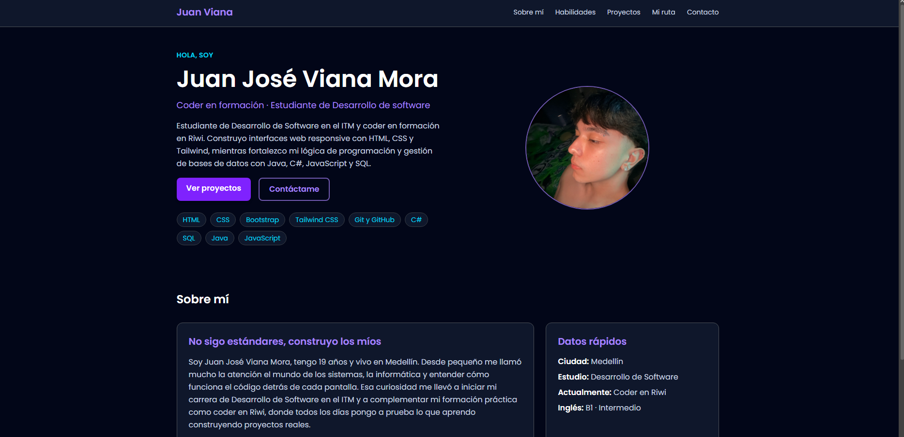

# Portafolio personal · Juan José Viana Mora

Portafolio web personal de un coder en formación: presenta quién soy, mis habilidades, mis proyectos, mi ruta de aprendizaje y mi horario. Está construido con HTML y **Tailwind CSS 4**, es responsive y está publicado en GitHub Pages.

**Sitio publicado:** https://juanjov7.github.io/portafolio/
**Repositorio:** https://github.com/JuanjoV7/portafolio

## Secciones
- **Portada:** presentación, botones de acción y tecnologías.
- **Sobre mí:** descripción personal y datos rápidos.
- **Habilidades:** frontend, backend y lógica, bases de datos y herramientas.
- **Proyectos:** Rueda Libre, Huellitas Milú, este portafolio y TecniControl.
- **Mi ruta y horario:** ruta de aprendizaje y tabla de horario semanal.
- **Contacto:** formulario con validación nativa (de demostración) y enlaces directos.
- **Footer:** enlaces rápidos.

## Qué se construyó con Tailwind CSS
- Todos los estilos son utilidades de Tailwind: no hay atributos `style` ni hoja de estilos propia, salvo un bloque `@theme` con la tipografía Poppins.
- Paleta oscura con fondos `slate-950` y `slate-900`, y acentos `violet` y `cyan`.
- Diseño responsive mobile-first con los prefijos `sm:`, `md:` y `lg:`: las grillas pasan de 1 a 2 y a 4 columnas.
- Componentes: botones, cards, etiquetas, tabla y formulario, con estados `hover:` y `focus:`.

## Accesibilidad y buenas prácticas
- HTML semántico: `header`, `nav`, `main`, `section`, `article`, `aside` y `footer`, con un solo `h1`.
- Imágenes con texto alternativo y formulario con `label` asociado a cada campo.
- Indicador de foco visible con `focus:ring` y navegación por teclado.
- Rutas relativas (`./img/...`) compatibles con GitHub Pages.

## Tecnologías
- HTML5
- Tailwind CSS 4 (Play CDN)
- Google Fonts (Poppins)
- Git y GitHub Pages

## Framework elegido y justificación
**Por qué:** quería una identidad visual propia, con un modo oscuro y una paleta violeta, y Tailwind me permite construirla con utilidades sin pelear con componentes predefinidos.

**Qué gano:** un diseño único y responsive, que veo directamente en el HTML.

**Qué acepto:** el Play CDN genera el CSS en el navegador del visitante y está pensado para prototipos; para un proyecto en producción lo recomendable es la CLI. Lo uso porque es un sitio estático de una sola página para GitHub Pages. Además, el HTML queda con más clases por elemento.

**Cómo lo mitigo:** ordeno las clases por categoría (layout, espaciado, tipografía, color y estados).

## Estructura
```
portafolio/
├── index.html
├── img/
│   ├── foto-perfil.jpg
│   ├── proyecto-rueda-libre.png
│   ├── proyecto-huellitas-milu.png
│   ├── proyecto-portafolio.png
│   └── proyecto-tecni-control.png
└── README.md
```

## Captura


## Autor
Juan José Viana Mora · Coder en Riwi y estudiante de Desarrollo de Software en el ITM · [GitHub](https://github.com/JuanjoV7)